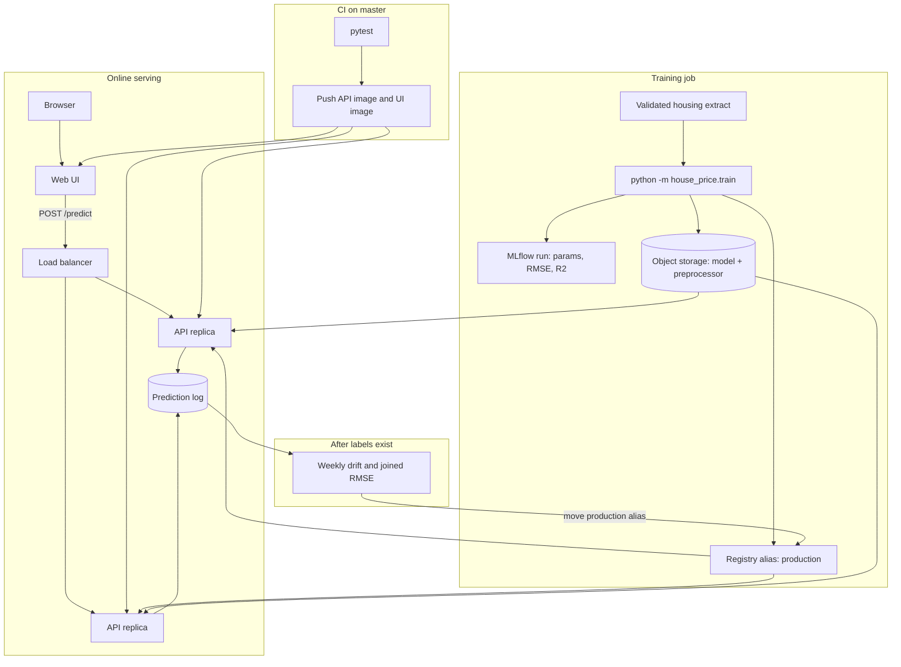
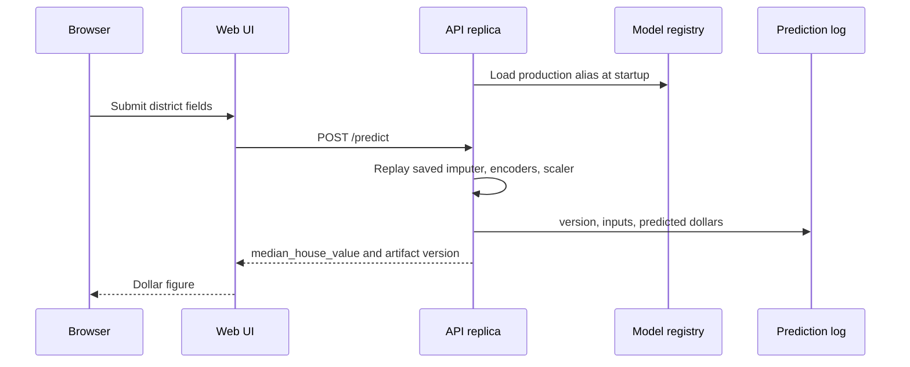

# Productionizing the house-price service

The Docker app in this repo trains a gradient boosting model from the research notebooks, serves `POST /predict`, and puts a Streamlit form in front of that API. That is a local loop: two containers, one volume, no history of runs, no check that tomorrow's districts still look like 1990 California. This note is the concrete follow-up, in the order that removes the most risk.

## Target architecture

Training and serving split. The API replicas only load a registered bundle. The form never sees the model file. Drift reads the prediction log, not the request path.



A single request, once that picture is in place:



The local compose file is the small version of the serving half only, and it still trains inside the API container. The sections below are how you get from that file to the diagram.

The code you would extend is small on purpose.

| Hook | Where |
|---|---|
| Training entry point | `python -m house_price.train` |
| Metrics already computed | `metadata.json` → `metrics.notebook_holdout` and `metrics.outer_test` |
| Bundle layout | `artifacts/<version>/{model.joblib,preprocessor.joblib,metadata.json}` plus `artifacts/latest.json` |
| Request body | `house_price.schemas.HousingFeatures` |
| Process config | `ARTIFACT_DIR`, `HOUSING_TGZ`, `FORCE_RETRAIN`, `PORT`, `API_URL` (UI only) |

Do these as separate changes. Each one has a finish line.

## 1. CI: test, build, and push

Add `.github/workflows/ci.yml`. On every pull request, install the package and run pytest. On a push to `master`, also build the image and push it. Do not train the 300-tree model inside CI; `tests/test_api.py` already fits a small stand-in, and the full fit belongs in a training job that publishes an artifact.

```yaml
name: ci

on:
  pull_request:
  push:
    branches: [master]

jobs:
  test:
    runs-on: ubuntu-latest
    steps:
      - uses: actions/checkout@v4
      - uses: actions/setup-python@v5
        with:
          python-version: "3.11"
          cache: pip
      - run: pip install -e ".[dev]"
      - run: pytest -q

  image:
    needs: test
    if: github.ref == 'refs/heads/master' && github.event_name == 'push'
    runs-on: ubuntu-latest
    permissions:
      contents: read
      packages: write
    steps:
      - uses: actions/checkout@v4
      - uses: docker/login-action@v3
        with:
          registry: ghcr.io
          username: ${{ github.actor }}
          password: ${{ secrets.GITHUB_TOKEN }}
      - uses: docker/build-push-action@v6
        with:
          context: .
          push: true
          tags: ghcr.io/${{ github.repository }}/house-price-api:${{ github.sha }}
      - uses: docker/build-push-action@v6
        with:
          context: ./frontend
          push: true
          tags: ghcr.io/${{ github.repository }}/house-price-ui:${{ github.sha }}
```

Two changes before that workflow is honest:

- Stop baking training into container start. The image should only serve. Training writes a bundle to object storage (or the registry in step 2) and the image loads it. `FORCE_RETRAIN=1` on every deploy refits against whatever CSV happens to be in the image, which will drift from the model you tested.
- Pin the Python dependencies (`pip freeze` into a lockfile, install from the lockfile in CI and in the Dockerfile). `scikit-learn` patch versions can change Lasso support and tree splits. The notebook path is only reproducible if the library versions are.

Gate the image job on the test job, as above. Add a third job later that runs `pytest` against a pulled image only if you need a smoke `POST /predict` in CI. A 15-tree fixture model checked into a test-only path is enough for that; do not commit the production `model.joblib`.

## 2. Experiment tracking and a model registry

`metadata.json` is a registry of one. The second training run overwrites `latest.json` and leaves the old directory on disk with no record of why it was better or worse.

Use MLflow. It is a single service, it stores parameters and metrics, and the model registry is the thing `latest.json` is pretending to be.

What to log from `house_price.train.train`, after `save_artifact` returns:

- params: the `hyperparameters` dict, `LASSO_ALPHA`, both split seeds and sizes, `target_cap_exclusive`, `sample_rows`, and the git SHA
- metrics: `notebook_holdout.rmse`, `notebook_holdout.r2`, `outer_test.rmse`, `outer_test.r2`
- artifacts: the version directory (`model.joblib`, `preprocessor.joblib`, `metadata.json`)
- tags: `algorithm=GradientBoostingRegressor`, dataset filename, row count

Promote a run to the registry instead of copying files by hand:

```text
mlflow models register --model-uri runs:/<run-id>/model --name house-price
```

Serve the alias `production`, not "whatever was trained last". The API's startup should resolve that alias (or a pinned version set by `MODEL_VERSION`) and refuse to boot if the alias is empty. Roll back by moving the alias, not by redeploying an older image, as long as the preprocessor and the model are logged together. They have to travel as one bundle. A new scaler with an old booster is a silent wrong model.

W&B is the alternative if the team already lives there. The fields above do not change. Do not log to both.

Keep the research notebooks out of this loop. When someone retunes the booster in `model-training.ipynb`, the result becomes a new set of constants in `house_price.config` plus a registered run, not a joblib dropped next to the notebook.

## 3. Where to run it

The service is a stateless HTTP process once the bundle is loaded. Pick the host based on who is already operating the cluster, not on the model.

| Option | Use it when | What you actually set up |
|---|---|---|
| Google Cloud Run | You want scale-to-zero and a single container | One service, 1 vCPU, 1–2 GiB RAM, min instances 1 so the model stays warm, request timeout 30s. The image does not train on start. |
| AWS ECS on Fargate | You are already on AWS | A service with two tasks, an ALB health check on `GET /health`, the bundle pulled from S3 in an entrypoint before uvicorn binds. |
| Azure Container Apps | You are already on Azure | Same shape: one container app, HTTP ingress, health probe on `/health`, model in Blob Storage. |
| A single VM | This is an internal tool with a few users | `docker compose` plus a systemd unit, Caddy or nginx in front, the volume backed up. This repo is already that deployment. |

Do not put the training job on the same service as the API. Training is a batch task (GitHub Actions, Cloud Run job, ECS task, or a small VM cron) that registers a model. The API only loads.

The current image trains on boot and runs as root so the compose volume is writable. Both are local conveniences. The production image should start as a non-root user, and the volume or object download path should be owned by that user (`fsGroup` on Kubernetes, or `chown` in an init container).

## 4. Monitoring and drift

`/health` only says the process loaded a file. It will stay green while the model quietly gets worse.

Log every prediction as one JSON line (or one row): timestamp, `artifact_version`, the nine request fields, and `median_house_value`. Do not log anything else until you have a reason. This is the table drift tests and later error analysis read.

Watch, from day one:

- request count, 5xx rate, and latency on `/predict` (p50 and p95). A booster this small should respond in well under 100 ms. A jump means the process is sick, not that the model changed.
- the distribution of predictions. Alert if the daily median prediction moves more than a threshold you set from the training holdout (start with a 15% shift week over week and tune it).
- input drift on the columns the model actually uses. `median_income`, `ocean_proximity`, latitude, and longitude carry most of this file. Population stability index on `median_income`, and a chi-square on `ocean_proximity`, weekly, against the training frame saved next to the bundle. Latitude and longitude should stay inside California; a pile of points elsewhere means a client is sending the wrong file.

You cannot compute RMSE in production until a district's true median shows up later. When it does, join it to the prediction log on district id and time, and plot RMSE by week next to the `outer_test.rmse` stored in the artifact. That gap is the only honest quality number. The 1990 file has no fresh labels, so this join is a product decision: someone has to decide which later sale or appraisal counts as the outcome.

Retrain when either the drift tests fire for two consecutive weeks or the joined RMSE is more than about 20% worse than the registered model's outer-test RMSE. Those numbers are starting points; write them down next to the registry entry so they are not folklore.

## 5. Data validation

`HousingFeatures` already rejects an unknown ocean label, a negative room count, and a household count of zero. That is the request check. Training needs its own, because a bad extract should fail the job before it overwrites `latest.json`.

Add a Pandera model (or Great Expectations if the data team already runs it) over the frame from `load_housing_data`:

- required columns, the nine features plus `median_house_value`
- `ocean_proximity` inside the five known labels
- latitude between 32 and 42, longitude between -125 and -114
- `median_house_value` greater than 0
- `total_bedrooms` null fraction under 5% (the research file is about 1%)
- row count above a floor (the research file has 20,640). A 200-row extract should not train a model that then gets aliased to production.

Run that check at the top of `train`, before the split. On failure, exit non-zero and do not write `latest.json`.

At request time, keep pydantic as the gate. Add one more check that is about the model rather than the type: if `median_income` is far outside the training range (for example above 15, the top of this file), return the prediction but set a response field `extrapolated: true`. Callers can decide whether to trust it. Do not silently clip. Clipping is how the $500,000 cap got into the training set in the first place.

## 6. Secrets and config

This service has no secret today, and the container should stay that way. The model file is not a secret. Database passwords, the MLflow tracking URI auth, and the object-storage credentials are.

Rules that match the code you have:

- Configuration is environment variables, read at process start. The ones that exist now are `ARTIFACT_DIR`, `HOUSING_TGZ`, `FORCE_RETRAIN`, `PORT`, and `API_URL` on the form. Add `MLFLOW_TRACKING_URI` and `MODEL_VERSION` the same way. Do not add a config file that gets copied into the image. The Streamlit theme file is presentation, not configuration of the model.
- Do not bake `.env` or cloud keys into the image. `.dockerignore` should keep ignoring anything that shows up later named `.env`.
- In GitHub Actions, the registry password is `GITHUB_TOKEN`. Any MLflow or cloud key goes in an Actions secret, passed only to the training job.
- On AWS use IAM roles for the task, not an access key in the task definition. On GCP use the Cloud Run service account. On Azure use a managed identity. The process then does not see a long-lived key at all.
- `GET /metadata` is fine on a local port. In a shared environment, do not expose it publicly, or strip `preprocessor` details if the feature list is considered internal. Predictions themselves are not sensitive in this dataset; do not pretend they are.

## 7. Scaling

The booster and the scaler fit in memory many times over. The limit is not the model. It is process layout.

- One uvicorn worker loads the bundle once. That is the right default, and it is what `docker/entrypoint.sh` does.
- Horizontal scale is more copies of that container behind a load balancer. Each copy loads the same registered version. Do not use a shared local volume as the source of truth once you have two copies; they will train or read different files. Load from the registry or from object storage at start.
- More uvicorn or gunicorn workers multiply memory by the worker count, because each worker has its own Python process and its own copy of the trees. Scale containers first. Add workers only when one container's CPU is the bottleneck.
- Autoscaling metrics: CPU and p95 latency, not request count alone. Minimum instances should be at least 1 if you care about the first-request latency. Cold start is the model load, which is short for this bundle but not free.
- Batch scoring (a nightly file of districts) should call `predict_median_house_value` in a job, not hammer `/predict` one row at a time from a laptop. The function is already separate from FastAPI for that reason.
- The notebook grid search (several forests, hundreds of fits) does not belong on the API box. If you revisit hyperparameters, run that search as a tracked experiment and change `house_price.config` from the winner.

## Suggested order

1. Lock dependencies and add the test-only GitHub Actions job.
2. Split training out of container startup. Publish the bundle, and make the image only serve.
3. Log runs to MLflow and point the API at a registry alias.
4. Add the Pandera check to `train`, and prediction logging to `/predict`.
5. Put two copies behind a load balancer with `/health` as the probe, running as a non-root user.
6. Turn on the drift checks once a week of prediction logs exists. Not before. Drift math on an empty table is noise.
