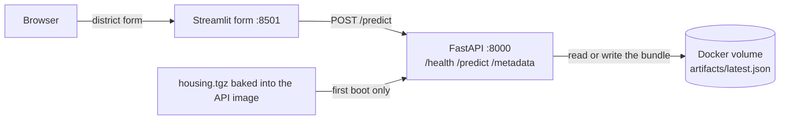
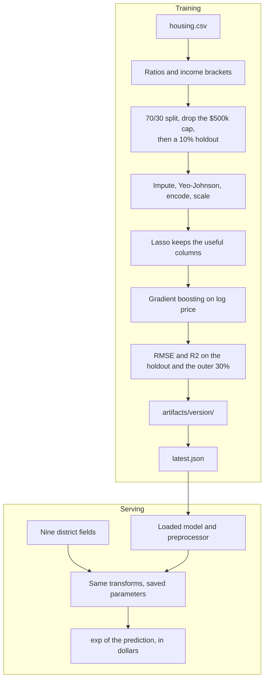

<p align="center"></p>

# House Price Prediction

A district-level model for California median house values, taken out of the research notebooks and put in two containers you can actually run: one scores districts, the other is a form that asks it to.

The notebooks under `01_research-and-development/` are still the lab notes. They are untouched. The Python package repeats their training path, writes a versioned model, and serves `POST /predict`. The Streamlit page on port 8501 is the way to type a district in and read a dollar figure back.

The data is the 1990 California census districts (the StatLib housing set shipped with Aurélien Géron's *Hands-On Machine Learning* examples). One row is a district, not a single house. The target is that district's median house value.

## Business case

Lenders, property platforms and appraisal teams want quick, consistent price estimates, and a model is only useful once it is packaged, tested and served. This repo takes a regression model from notebook to a versioned package, an API and automated deployment. It uses a public benchmark dataset, so it demonstrates the delivery pattern rather than a market-ready valuation model. [docs/BUSINESS_CASE.md](docs/BUSINESS_CASE.md) covers the use cases, an illustrative ROI model and the limits.

## What you get

| Piece | Where it lives |
|---|---|
| Research notebooks (unchanged) | `01_research-and-development/` |
| Package: load, features, train, score | `src/house_price/` |
| Prediction API | `GET /health`, `POST /predict`, `GET /metadata` on port 8000 |
| District form | `frontend/` on port 8501 |
| Containers | `Dockerfile`, `frontend/Dockerfile`, `docker-compose.yml` |
| Tests | `tests/` |
| Commands | `Makefile` |
| What to build next | [PRODUCTIONIZING.md](PRODUCTIONIZING.md) |

## Demo

[assets/house-price-demo.mp4](assets/house-price-demo.mp4) is a one-minute recording of this stack on a local machine. The form opens on a Near Bay district. Ocean proximity is switched to inland and median income to 2.5. **Predict median value** returns **$166,156**. The browser then opens `GET /health` (`status: ok`, model `v20261029T174453Z`) and the `/predict` schema in the API docs.

## Architecture

The browser never loads the model. Streamlit collects the nine fields and calls FastAPI. FastAPI owns the artifact volume. On a brand-new volume the API trains before it listens; after that it only loads `latest.json`.



Training and a later prediction share one preprocessor. The lambdas, the category maps, and the scaler are learned on the train split and frozen in the bundle. A request replays them. It does not refit anything.



## Run it with Docker

This is the path that brings the form and the API up together.

```bash
docker compose up --build
```

The first start trains into a Docker volume, then serves. The next start sees `artifacts/latest.json` in that volume and only loads the model. The form waits until `/health` is OK, then listens.

| URL | What it is |
|---|---|
| http://127.0.0.1:8501 | The district form. It opens on a real Near Bay row. Press **Predict median value**. |
| http://127.0.0.1:8000/health | `{"status":"ok", ...}` once the bundle is loaded |
| http://127.0.0.1:8000/docs | Interactive API docs |

Training the 300-tree booster is usually well under a minute on this file. Wait for the API log line `Serving on 0.0.0.0:8000`, then open the form.

A reference training run of this package (full file, the notebook hyperparameters) landed here:

- notebook holdout RMSE about $44,300, R² about 0.79 (1,374 districts)
- outer 30% RMSE about $44,100, R² about 0.79 (5,911 districts)
- Lasso kept all 12 model columns

Those numbers will move if the library versions move. `/metadata` is the score for the bundle you are actually serving.

Score the same Near Bay district from the shell:

```bash
curl -s http://127.0.0.1:8000/health

curl -s -X POST http://127.0.0.1:8000/predict \
  -H 'Content-Type: application/json' \
  --data @examples/predict_request.json
```

Or `make predict` while the stack is up. A healthy health check looks like:

```json
{"status":"ok","artifact_version":"v20261029T174453Z","algorithm":"GradientBoostingRegressor","selected_feature_count":12}
```

That district came back around $249,000. The file records about $281,500 for it. The gap is the model, not a broken request.

Fit a new version into the same volume:

```bash
FORCE_RETRAIN=1 docker compose up --build
```

Stop with `docker compose down`. Add `-v` if you also want to throw away the trained artifact.

## Run it without Docker

You need Python 3.11 or newer. Two terminals: one for the API, one for the form.

```bash
python3 -m venv .venv
source .venv/bin/activate
make install
make test
make train
make serve
```

In the second terminal, with the same virtualenv:

```bash
pip install -r frontend/requirements.txt
make web
```

`make web` opens the form on http://127.0.0.1:8501 and calls http://127.0.0.1:8000. Override the API with `API_URL` if it lives somewhere else.

`make train` writes:

```text
artifacts/<version>/model.joblib
artifacts/<version>/preprocessor.joblib
artifacts/<version>/metadata.json
artifacts/latest.json
```

The API reads `ARTIFACT_DIR` (default `./artifacts`) and loads whatever `latest.json` points at. `make serve` listens on port 8000.

## How a prediction is made

The package follows the notebooks in order. It does not re-run the giant model grid; that search already chose the booster, and startup just fits that configuration.

1. **Load** `housing.csv` from `01_research-and-development/datasets/housing/housing.tgz`. Rows stay in file order. If the tarball is missing, the loader downloads the same public copy.
2. **Enrich**, the same way `data-analysis.ipynb` does, before any split:
   - `income_bracket` from median income (`<= 5` low, `<= 10` middle, else high). Income in this file is already scaled, about equal to dollars / 10,000.
   - `age_group` from median *housing* age. The notebook builds it and then drops it for collinearity, and so does the package.
   - `rooms_per_household`, `bedrooms_per_household`, `population_per_household`, and `median_income_per_household`.
3. **Split** 70/30 with `random_state=42`, then drop districts whose recorded median is `$500,000` or more. The census file caps prices there, and the analysis notebook removes those rows so the model does not learn a fake ceiling.
4. **Hold out** 10% of the remaining training side with `random_state=0`. That inner holdout is the score the training notebook reports. The outer 30% is scored too and stored in the artifact metadata.
5. **Transform the target** with `log`. The notebook text says Yeo-Johnson; the code uses `np.log` and `np.exp`. The package does what the code does.
6. **Impute**. Categorical gaps that are rare take the training mode; gaps above 10% would take the label `"Missing"`. Numeric gaps (mostly `total_bedrooms`, about 207 rows) get a missing indicator plus the training mean.
7. **Yeo-Johnson** the continuous columns, using lambdas learned on the train split. Housing age, longitude, and latitude are left alone. `population_per_household` and `median_income_per_household` are binarized at 1, which is what the feature-engineering notebook does. The income ratio is almost always below 1, so that binary column carries very little. It is kept so the packaged path matches the research path.
8. **Encode**. Income brackets become 1, 2, 3. `ocean_proximity` labels rarer than 1% of training rows (this is `ISLAND`) collapse to `Rare`, then strings become integers ordered by mean log price.
9. **Scale** with `StandardScaler` fit on the train split.
10. **Select** with `Lasso(alpha=0.001, random_state=0)` and `SelectFromModel`, same as `feature-selection.ipynb`.
11. **Fit** `GradientBoostingRegressor(min_samples_leaf=3, n_estimators=300, learning_rate=0.3, random_state=0)`, the winner written down in `model-training.ipynb`.
12. **Serve**. `/predict` runs steps 2 and 6–9 with the saved parameters, keeps the selected columns, and returns `exp(prediction)` in dollars. The form sends the same JSON.

`median_income` on the request is the dataset's scaled income, not raw dollars. A value of 3.2 means about $32,000. `ocean_proximity` has to be one of `<1H OCEAN`, `INLAND`, `NEAR OCEAN`, `NEAR BAY`, `ISLAND`. `total_bedrooms` may be omitted. On the form, check **Bedroom count is unknown** and the page sends `null`.

## Tests

```bash
make test
```

`tests/test_features.py` checks the bracket cuts, the ratios, the price cap, and the raw file. `tests/test_preprocessing.py` checks that scaling is fit on the train split and that `ISLAND` is the rare label. `tests/test_api.py` trains a 15-tree model on 4,000 districts and calls `/health` and `/predict`. `tests/test_housing_form.py` checks the form's JSON body, including a null bedroom count, and the client that calls the API. The container's own training run uses the full file and 300 trees.

## Project layout

```text
01_research-and-development/   notebooks, the original joblib dumps, housing.tgz
src/house_price/               the package
  data.py                      read the tarball
  features.py                  brackets and ratios
  preprocessing.py             impute, transform, encode, scale
  train.py                     split, select, fit, save
  artifacts.py                 versioned bundles and latest.json
  api.py                       FastAPI app
  schemas.py                   pydantic bodies
frontend/                      Streamlit form
  app.py                       the page
  housing_form.py              payload and API client
examples/predict_request.json  the same Near Bay district the form opens on
docker/entrypoint.sh           train-if-needed, then uvicorn
```

## What this is not

The two containers are a local training-and-serving loop with a form in front. They do not track experiments, scan incoming rows, or deploy themselves anywhere. The shape of that next system, including the diagrams, is in [PRODUCTIONIZING.md](PRODUCTIONIZING.md).
